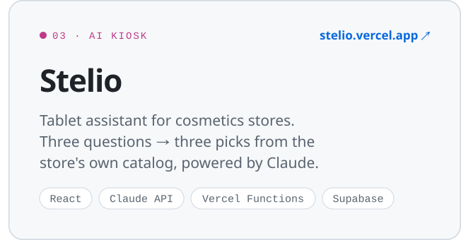

<picture>
  <source media="(prefers-color-scheme: dark)" srcset="assets/hero-dark.svg">
  
</picture>

### Hi, I'm Danil

Independent product engineer in Wrocław, Poland. I build web apps, CRMs and AI tools end to end: spec, data model, interface, deploy.
AI helps me move fast. Clear specs, secure backends and tests keep the result reliable.

### Selected work

<a href="https://www.gorower.pl"><picture><source media="(prefers-color-scheme: dark)" srcset="assets/project-gorower-dark.svg"></picture></a>

<a href="https://mokowash.pl"><picture><source media="(prefers-color-scheme: dark)" srcset="assets/project-moko-dark.svg"></picture></a><a href="https://stelio.vercel.app"><picture><source media="(prefers-color-scheme: dark)" srcset="assets/project-stelio-dark.svg"></picture></a>

Source code of client projects is private. Happy to walk you through the architecture on a call.

### Stack

<picture>
  <source media="(prefers-color-scheme: dark)" srcset="assets/stack-dark.svg">
  
</picture>

### Contact

[hello@am01.pl](mailto:hello@am01.pl) · [am01.pl](https://am01.pl) · [LinkedIn](https://www.linkedin.com/in/danil-drobnyi-58ab1a2ab/) · [X @chsto0x](https://x.com/chsto0x)
